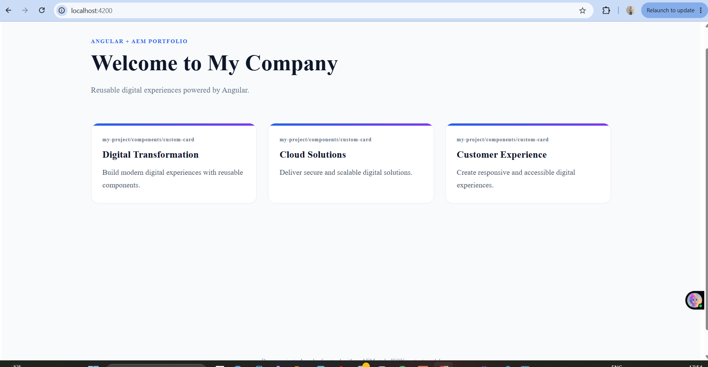

# AEM + Angular Portfolio

An Angular 16 frontend that renders content from an AEM-style JSON page model, alongside the source code for a custom Adobe Experience Manager (AEM) Card component with an authoring dialog and HTL template, packaged using Maven.

This project demonstrates how Angular components can render structured page content and how AEM components and content packages fit into an AEM-based application architecture.



## Features

### Angular Application

- Renders page titles and cards from a JSON page model.
- Reusable content-card component driven by `@Input`.
- Loads content through an Angular service using `HttpClient` and RxJS.
- Handles loading, empty, and error states, with a retry action when loading fails.
- Responsive layout with accessible status messages.
- Configurable content source for local mock JSON or an AEM endpoint.

### AEM Components and Packaging

- Custom Card component with an authoring dialog for title and description.
- HTL (HTML Template Language) component template.
- AEM content page structure in `ui.content`.
- Maven multi-module packaging using `ui.apps`, `ui.content`, and `all`.
- FileVault content packages for AEM deployment.

## Tech Stack

| Area | Technologies |
|---|---|
| Frontend | Angular 16, TypeScript, HTML, SCSS, RxJS |
| Data | HTTP, REST-style content loading, JSON page model |
| AEM | AEM component concepts, HTL, authoring dialogs |
| Build | Angular CLI, npm, Maven, FileVault |
| Backend for local demo | Node.js, Express |

## Project Structure

```text
aem-angular-portfolio/
├── src/                  # Angular application
│   ├── app/              # Components and services
│   └── assets/
│       └── homepage-model.json  # Mock page model
├── server/               # Express mock API
├── proxy.conf.json       # Angular development proxy
├── ui.apps/              # AEM components, dialog, HTL, client libraries
├── ui.content/           # AEM content structure
├── all/                  # Combined AEM content package
├── pom.xml               # Parent Maven build
├── package.json          # npm scripts and dependencies
└── angular.json          # Angular workspace configuration
```

## Getting Started

### Prerequisites

- Node.js 18 or later
- npm
- Java and Maven (required for building the AEM packages)

### 1. Install Dependencies

From the project root, run:

```bash
npm install
```

### 2. Start the Express Mock API

Open a terminal in the project root and run:

```bash
node server/server.cjs
```

The local API is expected to run at `http://localhost:3000`.

### 3. Start the Angular Application

Open a second terminal in the project root and run:

```bash
npm start
```

Open [http://localhost:4200](http://localhost:4200) in your browser.

The Angular development proxy forwards API requests to the local Express server. The current demo uses mock content stored in `src/assets/homepage-model.json`, so a running AEM instance is not required.

### 4. Build the Angular Application

```bash
npm run build
```

### 5. Build the AEM Packages

From the project root, run:

```bash
mvn clean package
```

The generated ZIP packages are placed in the relevant Maven modules' `target` directories.

## Current Status

| Item | Status |
|---|---|
| Angular application using mock JSON content | Tested locally |
| Local Express mock API | Implemented for the demo |
| Maven package build (`ui.apps`, `ui.content`, `all`) | Build successful |
| Package installation on a running AEM instance | Not yet tested |
| End-to-end integration with live AEM content | Not yet tested |

The application currently runs against mock JSON content served through the local Express API. The Maven content packages build successfully. Deployment to a live AEM instance and integration with live AEM content have not yet been tested.

## Possible Next Steps

- Install the packages on a local AEM SDK instance and verify the Card component and authoring dialog.
- Configure and test the Angular application against an AEM page-model endpoint.
- Expand unit test coverage for the content service and card component.
- Add a CI workflow for automated build and lint checks.

## Author

**Samta Ingle** — Frontend Developer (Angular)

GitHub: [@samtaingle](https://github.com/samtaingle)
